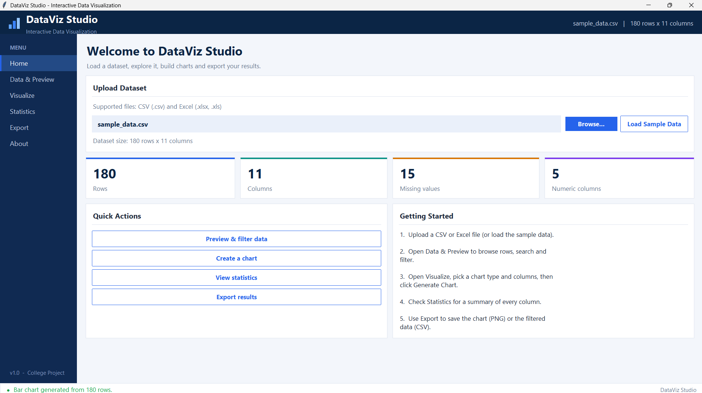
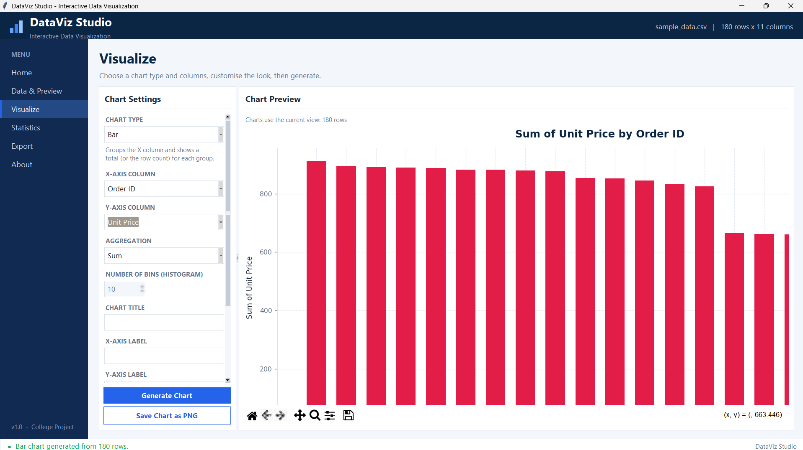
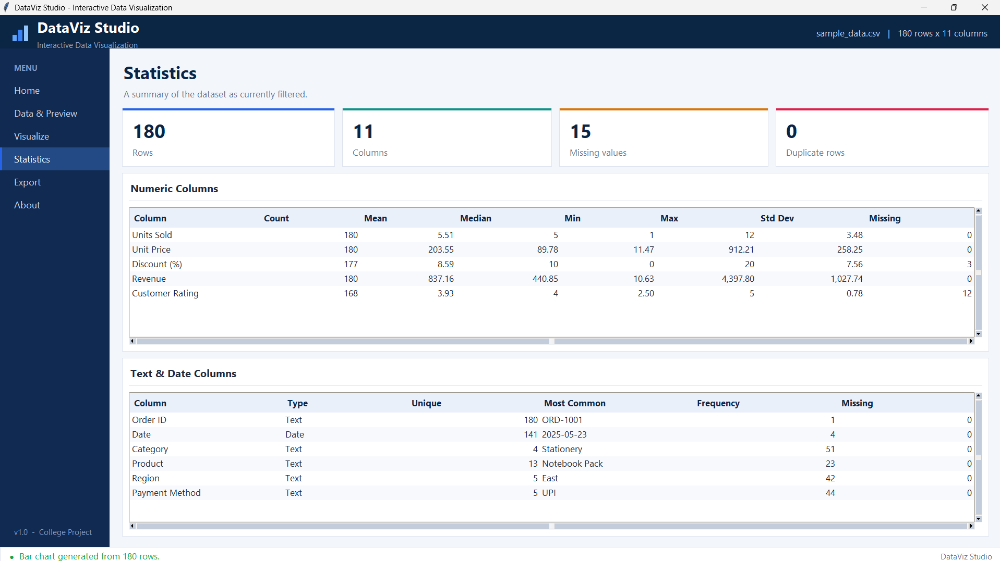
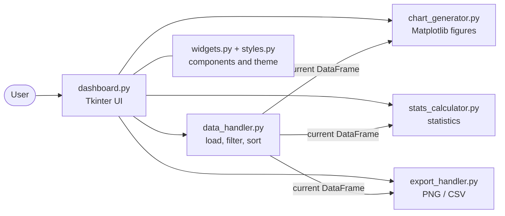

<div align="center">

# 📊 DataViz Studio

**Turn raw spreadsheets into insight, no code required.**

An interactive desktop application for exploring, filtering, summarising and visualising datasets.
Built with Python and Tkinter. Runs 100% locally, with no web framework, database, backend or AI.




</div>

---

## 📑 Table of Contents

- [Overview](#-overview)
- [Features](#-features)
- [Screenshots](#-screenshots)
- [Tech Stack](#-tech-stack)
- [Quick Start](#-quick-start)
- [How to Use](#-how-to-use)
- [Chart Guide](#-chart-guide)
- [Architecture](#-architecture)
- [Project Structure](#-project-structure)
- [Sample Dataset](#-sample-dataset)
- [Troubleshooting](#-troubleshooting)
- [Roadmap](#-roadmap)
- [License](#-license)

## 🎯 Overview

Analysing a CSV or Excel file usually means writing code or fighting with a spreadsheet.
**DataViz Studio** gives you a clean, guided workflow instead:

> **Upload → Preview & Filter → Visualise → Summarise → Export**

Everything happens on your own machine. Your data is never uploaded anywhere.

## ✨ Features

| | Feature | Details |
|---|---|---|
| 📂 | **Easy upload** | `.csv`, `.xlsx` and `.xls` via a native file dialog, or one click to load the bundled sample |
| 🔎 | **Data preview** | Scrollable table with 200-row paging, so large files stay fast. Click any heading to sort |
| 🧹 | **Search & filter** | By any column or all columns: *Contains, Equals, Greater than, Less than*. One click restores all rows |
| 📈 | **5 chart types** | Bar, Line, Pie, Scatter and Histogram, embedded in the app with zoom, pan and save tools |
| 🎨 | **Customisation** | Title, axis labels, colour picker and presets, grid toggle, aggregation (Sum, Mean, Median, Min, Max, Count), histogram bins |
| 🧮 | **Statistics** | Row, column, missing and duplicate counts. Numeric summaries (mean, median, min, max, std dev). Text and date summaries (type, unique values, most common) |
| 💾 | **Export** | Chart as high-resolution PNG, the current filtered and sorted view as CSV |
| 🛡️ | **Friendly errors** | Clear messages for empty, malformed or unsupported files and incompatible column choices |
| 🖥️ | **Responsive UI** | Modern navy-and-blue theme, high-DPI aware, minimum window 1100 × 700 |

## 🖼️ Screenshots

| Visualize | Statistics |
|:---:|:---:|
|  |  |

## 🛠️ Tech Stack

| Technology | Purpose |
|---|---|
| **Python 3.9+** | Core language |
| **Tkinter / ttk** | Desktop GUI with a custom theme |
| **Pandas** | Loading, cleaning, filtering and statistics |
| **Matplotlib** | Charts, embedded via `FigureCanvasTkAgg` |
| **OpenPyXL / xlrd** | Reading `.xlsx` / `.xls` files |

## 🚀 Quick Start

**1. Clone the repository**

```bash
git clone https://github.com/yogendra-08/dataviz-studio.git
cd dataviz-studio
```

**2. Create and activate a virtual environment**

```bash
python -m venv .venv
```

```bash
# Windows
.venv\Scripts\activate

# macOS / Linux
source .venv/bin/activate
```

**3. Install dependencies and run**

```bash
pip install -r requirements.txt
python main.py
```

> **Linux:** Tkinter is a separate system package. Install it with `sudo apt install python3-tk`.

## 📖 How to Use

1. **Home**: click **Browse...** to choose a file, or **Load Sample Data**. The filename, size and summary cards update.
2. **Data & Preview**: pick a column, a match type and a value, then **Apply Filter**. **Clear Filter** restores the original data. Click a column heading to sort.
3. **Visualize**: choose a chart type, X and Y columns, and optional title, labels, colour and grid, then **Generate Chart**. Use the toolbar under the chart to zoom, pan or save.
4. **Statistics**: review summaries of the current (filtered) data.
5. **Export**: **Save Chart as PNG** or **Export Dataset as CSV** (exactly what the preview shows).

## 📊 Chart Guide

| Chart | X column | Y column |
|---|---|---|
| **Bar** | Any column (categories) | Numeric column, or *(Count of rows)* |
| **Line** | Any column (dates or numbers work best) | Numeric column |
| **Pie** | Category column | Numeric column, or *(Count of rows)* |
| **Scatter** | Numeric column | Numeric column |
| **Histogram** | Numeric column | Not used |

## 🏗️ Architecture

The project separates the interface from the logic. Only the UI layer uses Tkinter, and the logic modules communicate through clear, friendly exceptions (`DataLoadError`, `FilterError`, `ChartError`, `ExportError`).



**Dual-state data model:** `DataHandler` keeps an untouched `original` DataFrame and a derived `current` DataFrame (original + active filter + active sort). The preview, charts, statistics and CSV export all read from `current`, so every screen always agrees.

## 📁 Project Structure

```text
dataviz-studio/
├── main.py              # Entry point
├── dashboard.py         # Main window, sidebar and all pages; connects every module
├── data_handler.py      # Load CSV/Excel, clean, search, filter, sort, paging
├── chart_generator.py   # Bar, Line, Pie, Scatter, Histogram figures
├── stats_calculator.py  # Dataset statistics
├── export_handler.py    # Save PNG and CSV
├── styles.py            # Colours, fonts, ttk theme
├── widgets.py           # Reusable widgets: Card, StatCard, ScrollableFrame
├── sample_data.csv      # Demo dataset
├── screenshots/         # README images
├── requirements.txt
└── README.md
```

> **Why `stats_calculator.py`?** A file named `statistics.py` would shadow Python's built-in `statistics` module for every library in the project and can cause confusing import errors, so it was renamed.

## 🧪 Sample Dataset

`sample_data.csv` contains **180 retail orders from 2025** with 11 columns: *Order ID, Date, Category, Product, Region, Units Sold, Unit Price, Discount (%), Revenue, Customer Rating, Payment Method*.
It includes a few missing ratings and discounts so the Statistics page has something to show.

**Try these charts:**

| Chart | X | Y |
|---|---|---|
| Bar | Region | Revenue |
| Line | Date | Revenue |
| Pie | Category | *(Count of rows)* |
| Scatter | Unit Price | Revenue |
| Histogram | Customer Rating | n/a |

## 🩺 Troubleshooting

| Problem | Solution |
|---|---|
| `ModuleNotFoundError: tkinter` | Linux: `sudo apt install python3-tk`. Windows/macOS: reinstall Python from python.org with Tcl/Tk included. |
| `ModuleNotFoundError: pandas` (etc.) | Activate the virtual environment, then `pip install -r requirements.txt`. |
| Excel file will not open | Make sure `openpyxl` (`.xlsx`) or `xlrd` (`.xls`) is installed. Only the first sheet is read. |
| "File is empty" / "no data rows" | The file has no header or rows. Open it in a spreadsheet to check. |
| Chart says a column is not numeric | Choose a number column for that axis (see the [Chart Guide](#-chart-guide)). |
| Chart says there are no rows | A filter removed every row. Click **Clear Filter**. |
| Window looks blurry on Windows | The app enables high-DPI mode automatically. Update your graphics driver if it persists. |

## 🗺️ Roadmap

- [ ] Choose which Excel sheet to open
- [ ] More chart types (box plot, heat map, stacked bars) and Seaborn styling
- [ ] Colour per series and multiple Y columns
- [ ] Dark mode toggle
- [ ] Save and load chart settings
- [ ] Edit values or drop rows / columns inside the app
- [ ] Automated test suite

## 📄 License

Released under the **MIT License**. See [LICENSE](LICENSE) for details.

---

<div align="center">

⭐ If you find this project useful, consider giving it a star.

</div>
